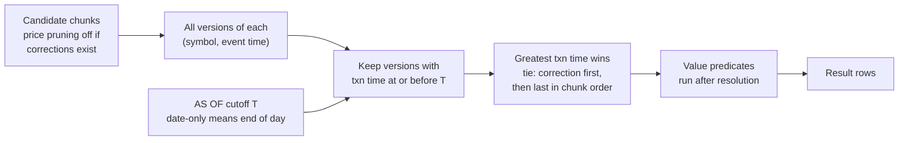

# PitDB architecture

PitDB is a single-process, in-memory engine for OHLCV time series. Rows live in immutable per-symbol chunks of raw `float64` columns. Each chunk carries a label of min/max bounds (a zone map), and queries skip chunks whose label proves they cannot match. Revisions are stored as extra versions with their own transaction time, so `AS OF` queries return what was known at a past moment. This file defines the semantics; the [README](README.md) shows the end-to-end flow, [METHODOLOGY.md](METHODOLOGY.md) the measurement protocol, and [BENCHMARK_RESULTS.md](BENCHMARK_RESULTS.md) the numbers.



## Key design decisions

Each choice favors a correct answer first and speed second. The last column is what it costs.

| Decision | Why | Trade-off |
|---|---|---|
| Prune with per-chunk labels, conservatively | A chunk is skipped only when its label proves no row can match | Some chunks are kept needlessly; price pruning is off once corrections or duplicate keys exist |
| Resolve versions before value predicates | Filtering physical rows first would drop a revision and expose the stale value | Surviving chunks are reconstructed and resolved before the exact filter, so broad queries gain little |
| Store corrections as new versions with a transaction time | History is kept, so `AS OF` reproduces what was known; compaction merges chunks without dropping versions | Every version stays in memory; compaction only reduces chunk overhead |
| Model base rows as learned at their event time | The engine cannot know when a provider first published a value | A model assumption, not a measured arrival time |
| Immutable chunks and labels; accessors return copies | Callers cannot alter stored payloads or invalidate zone maps | Extra copying on read |
| Raw, uncompressed `float64` columns | A simple, predictable layout with cheap labels | No storage saving; none is claimed |
| Bounded SQL subset that rejects everything else | Silently ignoring `OR` or `ORDER BY` would return wrong rows | Narrow grammar; callers get `UnsupportedQueryError` |
| Reject ambiguous time instead of guessing | DST-fold and DST-gap literals and mixed naive/aware timelines raise errors | Callers must supply unambiguous times |
| Queries see finalized chunks only; ingestion and compaction are atomic | No half-built chunk is ever visible, and a failure rolls back | Call `flush_all()` before expecting buffered rows |
| Monthly chunks by default; `hourly` strategy for one-minute data | Smaller chunks prune more but add label and index overhead | One benchmark favored quarterly over the monthly default, so the default is not claimed optimal |
| Single process, in memory, methods serialized by a lock | The smallest design that supports the research use | No durability, transactions or reader isolation |

## Codemap

| Path | Role |
|---|---|
| `src/replay/data_loader.py` | CSV to validated DataFrame with UTC nanosecond timestamps |
| `src/replay/replay_harness.py` | `ReplayHarness`: sequential, no-lookahead row iterator (no length, indexing or peek) |
| `src/store/chunk.py`, `label.py` | `Chunk` (frozen raw columns) and `ChunkLabel` (frozen zone map) |
| `src/store/chunk_builder.py`, `chunk_boundary.py` | `ChunkBuilder` buffers one symbol's window; `MonthlyBoundary` and `DurationBoundary` end it |
| `src/store/chunk_store.py` | `ChunkStore`: ingestion, corrections, compaction, visibility index, lock |
| `src/store/validation.py` | Value-column rules and timestamp normalization shared by the store |
| `src/query/sql_parser.py`, `schema.py` | Bounded SQL subset, `AS OF` extraction, columns, aliases, literal typing |
| `src/query/predicate.py`, `pushdown.py` | Predicate tree (label, row and vectorized evaluation) and chunk selection |
| `src/query/versioning.py`, `executor.py` | Version resolution; `QueryExecutor` and `QueryResult` |
| `src/baselines/full_scan.py` | `FullScanQueryEngine`: row-wise comparison engine that reads every chunk |
| `src/pipeline.py` | `run_pipeline` and the CLI (the CLI ingests a base CSV only; corrections need the Python API) |

## Storage

A finalized `Chunk` holds one symbol, event timestamps, named raw `float64` column buffers and, for correction chunks, a transaction time per row. Nothing is compressed: `decompress()` only rebuilds a DataFrame. Chunks and labels are frozen, and accessors return copies, so callers cannot alter stored payloads.

A `ChunkLabel` holds symbol, event-time bounds, `close` min/max, row count, chunk ID and, for correction chunks, transaction-time bounds. Missing transaction-time bounds mark base data. `close` is the only value column with a zone map, so value columns must include `close`, be unique nonblank strings and avoid `symbol`, `timestamp`, `_txn_time` and `_is_correction`. SQL sees only OHLCV columns.

`ChunkBuilder` keeps one active window per symbol. `MonthlyBoundary` starts a new chunk when the (year, month) of the stored timestamp changes. `DurationBoundary` starts one when elapsed absolute time reaches its duration, including across DST changes. Smaller chunks prune more but add label, index and DataFrame overhead.

`ChunkStore` also keeps a visibility index: parallel lists sorted by a key per chunk (base chunk: earliest event time; correction chunk: earliest transaction time). A cutoff lookup is a bisect, so it returns every chunk that might hold a visible row. Row-level filtering still follows. Insertion into the sorted lists is linear.

## Time and timezones

Date-only literals name a whole day, and queries resolve literals in the stored timezone. CSV loading requires ISO 8601, reads offset-less strings as UTC and stores UTC nanoseconds, so date-only queries over the CSV fixtures mean UTC calendar days. The loader rejects missing or invalid timestamps, `inf`, NaN in open/high/low/close (NaN volume is allowed), booleans, duplicate `(timestamp, symbol)` pairs, decreasing timestamps per symbol and bad symbols.

Direct ingestion keeps one timeline per store, naive or aware. Aware inputs convert to the zone of the first aware input without changing the instant. Mixing naive and aware timestamps is rejected.

| Stored data | SQL literal | Comparison |
|---|---|---|
| Aware | Aware (`Z` or offset) | Absolute instants |
| Aware | Naive | Localized in the stored zone |
| Naive | Naive | Wall times |
| Naive | Aware | Offset dropped, literal's own wall time compared |

An ambiguous (DST fold) or nonexistent (DST gap) local literal is rejected with `UnsupportedQueryError`, including in `AS OF`. A fixed-offset zone has no DST rules, so use a named zone when they matter. The parser never infers the caller's location.

Date-only forms are `'2024-01-01'` and `'20240101'`. For every operator they act on day boundaries: `=` is the half-open day, `<` is before the day starts, `<=` is before the next midnight, `>` starts at the next midnight, `>=` starts at the day start. `TIMESTAMP AS OF '<date-only>'` means the last nanosecond of that day. A literal with a time component is an exact instant. `IN` over date-only datetimes is rejected; `IN` over exact timestamps works.

## Bitemporal versioning

Each row is a version of the key `(symbol, event timestamp)` with a transaction time, the moment it became known. `ingest_row()` models a base row as learned at its own event time. That is a model assumption, not a measured arrival time. It accepts duplicate keys while event times stay nondecreasing per symbol, including across chunk and `flush_all()` boundaries.

`ingest_correction(timestamp, symbol, values, transaction_time)` publishes one version learned at an explicit time. The transaction time cannot precede the event's instant, and awareness must match the store. It bypasses the active builders, does not need a base row for that key, and does not advance base ordering.

Resolution runs in three steps. It keeps versions with transaction time at or before the cutoff (no cutoff keeps all). Per key, the greatest transaction time wins. At equal transaction time a correction beats a base row, then the last in chunk order wins. Value predicates run after that. A base `close` of 100 revised to 50 does not match `close > 75` once the revision is visible, because filtering physical rows first would drop the revision and expose the stale 100.

`compact_corrections()` merges each symbol's correction chunks into fewer, larger ones, keeping per-row transaction times, answers and tie order. It never turns corrections into base rows or drops versions. Versioned queries (`AS OF`, corrections or duplicate base keys) return rows sorted by `(timestamp, symbol)`; plain queries return chunk order.

## Query contract

The parser accepts one statement: `SELECT * FROM data [alias] [TIMESTAMP AS OF '<literal>'] [WHERE ...]`. Predicates are `AND` terms of `column op literal` with `=`, `>`, `>=`, `<`, `<=`, or `column IN (literals)`, with optional parentheses. Columns are `symbol`, `timestamp`, `open`, `high`, `low`, `close`, `volume`; `date` is an alias for `timestamp` and `price` for `close`. Qualifiers must be `data` or the alias. Symbols need quoted strings. Numeric literals must be finite decimals.

```sql
SELECT * FROM data TIMESTAMP AS OF '2024-06-01'
WHERE symbol = 'AAPL' AND date >= '2024-03-01' AND price > 150
```

`UnsupportedQueryError` (a `ValueError` subclass) rejects everything else:

- projections other than `*`, aggregates, `DISTINCT`, joins, subqueries, `GROUP BY`, `ORDER BY`, `LIMIT`
- `OR`, `NOT`, `!=`, `BETWEEN`, `LIKE`, and any other operator
- `VERSION AS OF` and any time-travel form not directly after `FROM data`
- bare numeric timestamp or symbol literals, `nan`, `inf`, `IN` over date-only datetimes
- datetimes outside the `datetime64[ns]` range (about 1677 to 2262)
- ambiguous or nonexistent DST local times, multiple statements, unused AST clauses

Limits on accepted input: 65,536 characters, 8,192 tokens, parenthesis depth 32 and 256 `AND`-joined predicates. They bound input size and are not resource isolation.

### Pruning safety

A label test returns `False` only when no row in the chunk can match; `True` keeps the chunk. Symbol and event-time predicates constrain the logical key, so pruning on them is safe before resolution. `AS OF` also skips chunks with no visible row. String ranges and non-`close` value columns never prune.

Price pruning is off whenever the store holds corrections or duplicate base keys. A superseding value can fail a price predicate while its stale predecessor passes, so both must reach resolution. Pruning is never a substitute for exact filtering: surviving chunks are concatenated, versions resolved, then one vectorized mask applied. `enable_pruning=False` runs the same path over all chunks; `FullScanQueryEngine` evaluates row by row. All paths share the parser, predicates and resolution, so agreement checks catch execution and pruning mistakes but cannot validate shared semantics independently.

`AS OF` is not `O(log n)` end to end. The cutoff bisect is `O(log n)`, but returning `k` labels costs `O(k)`, diagnostics traverse labels, and reconstruction, resolution and filtering follow. `QueryResult.selectivity` is returned logical rows over stored physical rows, versions included.

## Invariants and failure behavior

- **Visibility.** Queries, labels and row counts see finalized chunks only. Call `flush_all()` before expecting buffered rows. It ends the ingestion session, but per-symbol ordering is still enforced afterward.
- **Atomic ingestion.** `ingest_from_replay()` and `ingest_dataframe()` roll back store state on any failure. A completed chunk is published before its builder resets. `flush_all()` removes a builder only after publishing, so a failed flush keeps its rows (earlier symbols may already be published).
- **Atomic compaction.** Replacement groups are built first, then swapped in; a failure restores the previous state. Failed attempts can consume chunk IDs, so IDs need not be contiguous.
- **Concurrency.** `ChunkStore` methods are serialized by a re-entrant lock. There are no transactions and no reader isolation, so a caller needing a consistent multi-call view must coordinate.
- **Source data.** `ReplayHarness` holds the DataFrame by reference; do not mutate it during replay. Each yielded value array is a copy.

## Non-goals

No durable file format, WAL, network service, general SQL planner or provenance service. Values stay uncompressed `float64`, and every version stays in memory; compaction reduces chunk overhead only. Benchmark limits are in [METHODOLOGY.md](METHODOLOGY.md).
