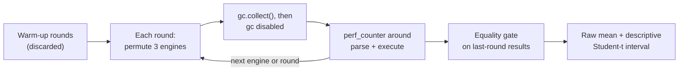

# Methodology

How PitDB's benchmarks are measured, what they can support, and what they cannot. Every number lives in [BENCHMARK_RESULTS.md](BENCHMARK_RESULTS.md); semantics live in [ARCHITECTURE.md](ARCHITECTURE.md). [README](README.md) | [Commands](All_Commands.md)

## Three paths compared

Every query runs through three engines over the same store, and the pruned engine is always reported against a named baseline.

| Path | Chunks read | Predicate evaluation | Role |
|---|---|---|---|
| `FullScanQueryEngine` | All | Row-wise | Baseline: a simple scan that rebuilds a DataFrame per chunk on every call |
| `QueryExecutor(enable_pruning=False)` | All | Vectorized | Control: vectorized execution without label pruning |
| `QueryExecutor` | Candidates only | Vectorized | The engine as shipped |

Speedup is the baseline's raw mean latency divided by the pruned path's raw mean latency. The control separates the gain from skipped chunks from the gain of replacing Python row iteration with pandas masks. A broad query that skips nothing shows up as roughly 1x against the control.

## Correctness gates

Each benchmark checks that the three paths return the same ordered rows, values, columns and dtypes (`pd.testing.assert_frame_equal`, exact) before a speedup is reported. A failed gate raises and no speedup is published for that comparison. The paths share the SQL parser and version-resolution code, so these gates are regression checks, not independent oracles. Semantics are covered separately by the unit, property-based and failure-injection tests.

## Timing protocol

Latency is wall-clock `time.perf_counter()` around parse plus execute, in one warm process, with engine calls interleaved so no engine always runs first.

- **Permutation cycles.** Rounds rotate through all 6 orderings of three engines. The requested trial count rounds up to whole cycles (18 by default, with 3 warm-up rounds), so each engine holds each position equally often. `requested_trials` and `sample_count` record both counts.
- **GC outside the clock.** Before every call, warm-up or timed, `gc.collect()` runs and collection is then disabled, so no engine pays for another's garbage. Collection is restored afterward.
- **Timed scope.** Parsing, label pruning (where enabled), chunk decompression, version resolution and filtering are timed. Data loading and store construction are not.
- **What this does not buy.** Interleaving reduces order and GC bias. It does not make trials independent or add cold-cache or fresh-process isolation.

## Statistics

The raw arithmetic mean is the headline estimator, and every speedup uses it.

- **Samples.** Each path keeps its latency samples in acquisition order, plus count, mean, sample standard deviation and median.
- **Trimmed mean.** A trimmed mean (slowest 15% dropped) is stored as a labeled descriptive view and never feeds a speedup.
- **Intervals.** The `ci95` fields are Student-t, `mean +/- t(0.975, n-1) * s / sqrt(n)`. A 1.96 normal value would be far too narrow at small n. SciPy is not a dependency, so `benchmarks/stats.py` embeds a table for 1 to 30 degrees of freedom and interpolates beyond.
- **Reading them.** Coverage is not established for correlated wall-clock samples. Overlap or separation of intervals is descriptive; the suite makes no significance claims.

## Memory accounting

The memory headline is the per-query `tracemalloc` peak. Process RSS is a diagnostic only.

- **Peak allocation.** `tracemalloc` peak above the pre-call traced total, for the three engines over Q1-Q5, in one process. Engines rotate through every ordering across 18 repeats, `gc.collect()` runs before each call and one unrecorded warm pass precedes recording. Allocations outside Python and NumPy allocators are not traced.
- **RSS.** Reported only as a labeled diagnostic: 4 KiB page resolution, a 1 ms sampler thread, fixed order, one shot, in a process of roughly 100 MB. It cannot resolve a query that allocates a few hundred KiB, so it is neither compared between engines nor charted.
- **Storage.** Numeric columns are uncompressed float64, so payload bytes match the source by construction. That is an invariant, not a result, and no compression or storage-reduction claim is made. The DataFrame, object-graph and payload byte counts use different accounting and are not a ratio.

## Workloads

- **Real fixtures.** Q1-Q5 on the committed daily fixture and three queries on the 1-minute fixture ([data/README.md](data/README.md)). A selectivity sweep uses trailing time ranges at five targets and records achieved selectivity, not the target.
- **Synthetic scale sweep.** Seeded synthetic OHLCV, 501 rows per symbol, monthly chunks, a narrow single-symbol query and a broad full-range query at 1x, 10x, 100x and 1000x. Trials/warm-up per point are 18/3, 18/3, 12/2 and 6/1, because one row-wise call at the top point costs on the order of 100 s. Each point records its own `protocol`.
- **Bitemporal AS OF.** Synthetic, with 1-3 versions per corrected key (60/30/10%), each learned 1-90 days after the last, so transaction times spread across history. AS OF is swept over cutoffs that make about 0, 25, 50, 75 and 100% of versions visible, plus the end of the base data, with the 50% cutoff as the primary scenario. A first design queried AS OF the last base timestamp; that pruned every correction chunk, a best case, and was replaced. Current-state queries run before and after `compact_corrections()` (18 trials, 2 warm-up).
- **Chunk granularity.** Weekly, monthly and quarterly chunks over a grid of 3 symbols by 3 date windows with a median-close price band (18 trials, 3 warm-up). Pruned and baseline latency are reported separately because the ratio rises with finer chunks largely as the baseline slows.
- **Seeds.** A fixed seed reproduces generated data, not wall-clock latency.

## Limits

Stated once here; other documents link to this list.

1. **Tiny real fixture.** Needle-query ratios on the real data mostly reflect the baseline's fixed per-chunk cost and do not extrapolate. The synthetic scale sweep is the only larger-scale evidence.
2. **Broad queries gain nothing over the control.** When pruning skips no chunks, the pruned path matches the vectorized control (about 1x).
3. **The row-wise baseline overstates ratios.** It is deliberately simple. The control ratio is the conservative figure.
4. **The 1000x point has 6 trials and 1 warm-up round.** One permutation cycle gives a wide interval, so its ratios must not be compared with other points without that caveat.
5. **One warm process, one session.** There is no cold-cache or fresh-process isolation, trials are not independent, and between-session variance is not measured.
6. **Single machine, not idle.** One laptop under the tuning below, with light background applications open; see the provenance section of BENCHMARK_RESULTS.md.
7. **Synthetic correction model.** The bitemporal and granularity results depend on generated corrections and one synthetic dataset. AS OF speedup varies with the cutoff, and no granularity default is implied.
8. **Shared-code equality.** The gates above cannot catch a bug in the shared parser or version resolver.
9. **Dirty tree, split boots, later cleanup.** The run measured a dirty working tree, identified by its source hash rather than by the commit. It spans two machine boots because a power loss interrupted the suite and the last two benchmarks were rerun under one run ID. A later comment and import cleanup changed the source hash, so the measured snapshot no longer matches the checked-in tree until the suite is rerun.

## Provenance

Every result file carries a manifest, and the publisher refuses to write results that its own checks cannot vouch for.

- **Manifest.** Run ID, UTC start and completion, completion flag, git commit and worktree status, SHA-256 of every source file (`src/`, `benchmarks/`, `charts/`, requirements and setup files) plus a combined hash, fixture file hashes or data fingerprints, hardware, dependency versions, thread environment and parameters.
- **Atomic publish.** At completion the source and fixtures are re-hashed. A mismatch raises and nothing is published; otherwise strict JSON is written to a temporary file and renamed into place.
- **One run.** `run_suite.py` assigns one run ID to all five benchmarks. Standalone runners join a session by sharing `PITDB_BENCHMARK_RUN_ID`.
- **Charts.** `charts/generate_all.py` requires one run ID and source hash across all results, and its manifest binds each PNG to the hashes of its input JSON. The manifest fingerprints files; it does not prove every metric correct.
- **Withdrawn claims.** An earlier 2.7x memory comparison is withdrawn: it compared numeric column buffers with a whole DataFrame. Earlier speedup headlines (for example 629.70x at the 1000x point) are superseded by the figures in BENCHMARK_RESULTS.md and are not carried forward.

## Environment and tuning

Python 3.11 or newer. The published run used the `performance` CPU governor, single-thread environment variables (`OMP_NUM_THREADS`, `OPENBLAS_NUM_THREADS`, `MKL_NUM_THREADS` and others set to 1, `PYTHONHASHSEED=0`) and a single pinned core. Steps and exact settings are in [All_Commands.md](All_Commands.md#benchmark-environment); untuned timings should be disclosed as such.
