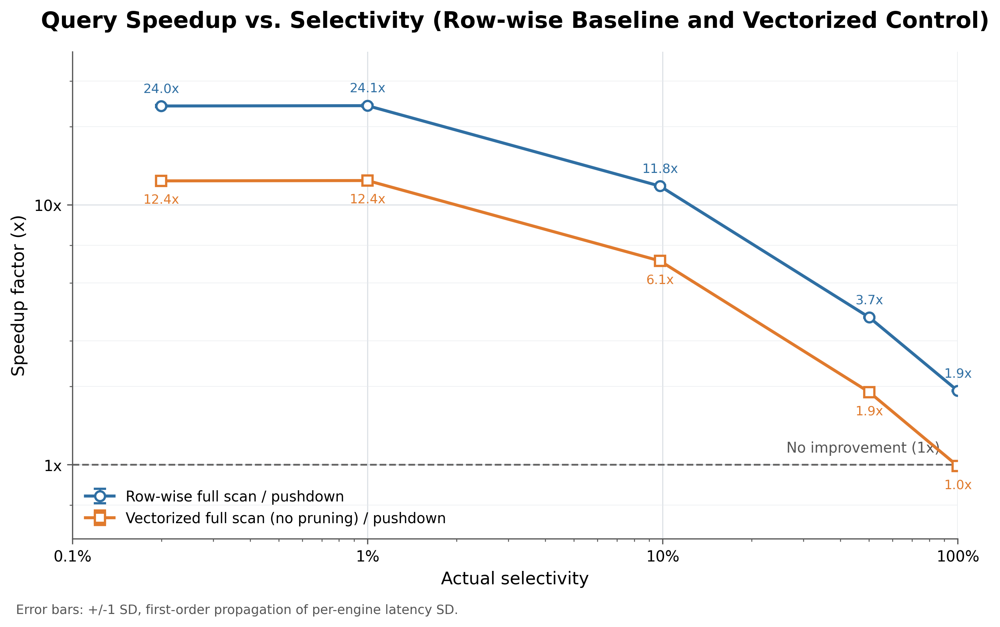
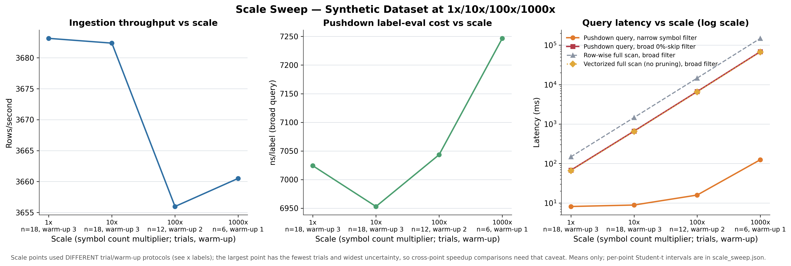
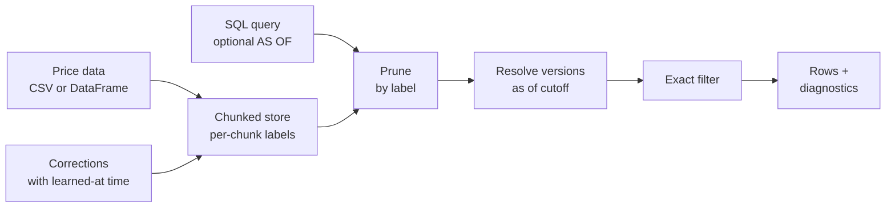

# PitDB

PitDB is an in-memory Python engine for stock-price bars (OHLCV) that answers a SQL subset, including point-in-time `AS OF` queries, and skips data chunks that cannot match.

Backtests must not see data corrections that were published later, so every correction carries the time it was learned and an `AS OF` query returns only what was known at the cutoff. Selective queries stay fast because each chunk has a label (symbol, time range, price range) and chunks whose label cannot match are never read.

Scope: an in-process research prototype, not a database server (see [Scope](#scope)).

[Architecture](ARCHITECTURE.md) · [Methodology](METHODOLOGY.md) · [Full results](BENCHMARK_RESULTS.md) · [Commands](All_Commands.md) · [Data fixtures](data/README.md)

## Results at a glance

Baseline is the row-wise `FullScanQueryEngine`. The like-for-like control is the same engine with pruning off ("vectorized"), which separates skipped work from pandas speed. Speedup is baseline mean latency divided by pruned mean latency, from one run on one laptop core (details in [BENCHMARK_RESULTS.md](BENCHMARK_RESULTS.md)).

| Workload | vs row-wise baseline | vs vectorized control |
|---|---|---|
| Real fixture (5,010 rows), needle queries Q1-Q4 | 23.76x-41.17x | 14.71x-24.16x |
| Synthetic narrow query, 5,010 to 5,010,000 rows | 12.17x to 799.05x | 8.12x to 534.34x |
| Synthetic broad query, nothing pruned | 2.17x-2.21x | 0.97x-0.98x |
| `AS OF` at the 50%-visible cutoff, 1-50% of rows corrected | 1.98x-2.11x | 1.72x-1.95x |

<p>


</p>

## How it works



Pruning is conservative: it may keep a chunk it did not need, but never skips one that could change the answer. Values are stored as raw, uncompressed `float64`. Semantics: [ARCHITECTURE.md](ARCHITECTURE.md).

## Credibility

The numbers describe what was measured, and these limits apply to them. [METHODOLOGY.md](METHODOLOGY.md) has the full list.

- **Tiny real fixture.** The large needle-query ratios mostly reflect the baseline's fixed per-chunk cost and do not extrapolate; the vectorized column is the fairer comparison.
- **Broad queries gain nothing.** They are about 2.2x faster than the row-wise baseline and about 0.98x against the vectorized control.
- **Thin top scale point.** The 1000x point has 6 trials; other points have 12 to 18.
- **Corrections erode the speedup.** The current-state speedup falls from 2.22x to 1.02x at 50% corrected; `compact_corrections()` recovers only part (1.24x).
- **Default granularity was not fastest.** Quarterly chunks beat the default monthly ones (3.293 ms vs 3.738 ms) on one synthetic dataset.
- **Single session.** One warm process, descriptive Student-t intervals, and no compression or storage-saving claim. The measured source snapshot differs from the current tree after a later cleanup (see Provenance in [BENCHMARK_RESULTS.md](BENCHMARK_RESULTS.md)).

## Quickstart

Python 3.11+ is required; `make setup` accepts 3.11 or 3.12. From the repository root:

```bash
make setup        # creates .venv, installs pinned requirements and the package
make test         # runs the test suite
```

Query the committed daily fixture (no download needed):

```bash
.venv/bin/python -m src.pipeline \
  --data-csv data/cache/all_symbols_daily.csv \
  --query "SELECT * FROM data WHERE symbol = 'AAPL' AND date = '2024-03-01'"

.venv/bin/python -m src.pipeline \
  --data-csv data/cache/all_symbols_daily.csv \
  --query "SELECT * FROM data TIMESTAMP AS OF '2024-06-01T00:00:00Z' WHERE symbol = 'AAPL'"
```

Each run prints row count, selectivity and chunks skipped. Use `--chunk-strategy hourly` for `data/cache/all_symbols_1m.csv`; `--query` may be repeated. The CLI ingests the base CSV only: corrections come in through `ChunkStore.ingest_correction()` in the Python API.

Grammar: one `SELECT * FROM data`, an optional `TIMESTAMP AS OF '<time>'`, and a `WHERE` of `AND`-joined `=`, `<`, `<=`, `>`, `>=` and `IN` predicates over `symbol`, `timestamp` (alias `date`), `open`, `high`, `low`, `close` (alias `price`) and `volume`. Anything else raises an error. Rules for literals and timezones: [ARCHITECTURE.md](ARCHITECTURE.md#query-contract). Benchmark reproduction and CPU tuning: [All_Commands.md](All_Commands.md).

## Project layout

| Path | Purpose |
|---|---|
| `src/store/` | Chunk boundaries, builders, labels, validation, indexes |
| `src/query/` | SQL parser, typed predicates, pruning, version resolution |
| `src/baselines/`, `src/replay/` | Row-wise comparison engine; CSV validation and replay |
| `src/pipeline.py` | CSV ingestion and query CLI |
| `benchmarks/`, `charts/` | Runners, statistics, provenance manifests, chart generation |
| `tests/`, `data/` | Unit, property-based and integration tests; cached fixtures |

## Scope

PitDB is an in-process research engine. `ChunkStore` methods are serialized by a lock, but there are no transactions or reader isolation. There is no durable storage, no general SQL, and no certified market-data history. Base rows are modeled as learned at their event time; the engine cannot know when a provider first published a value.
